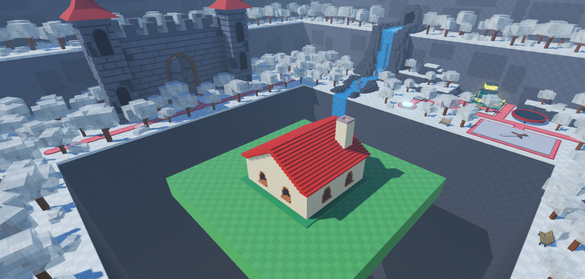
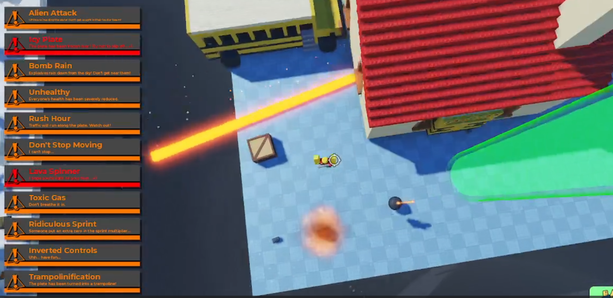
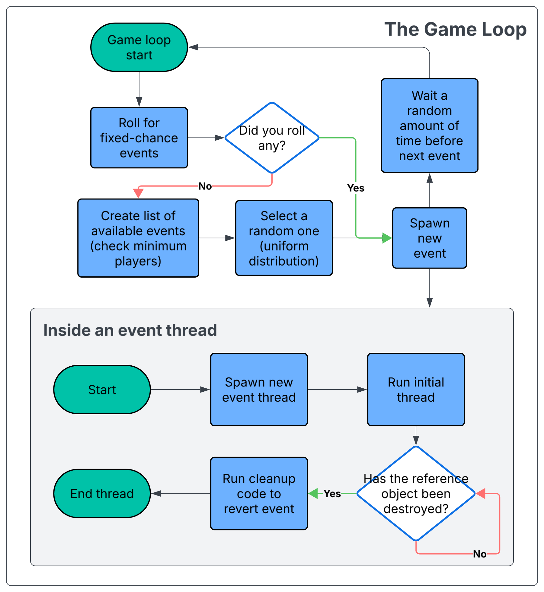
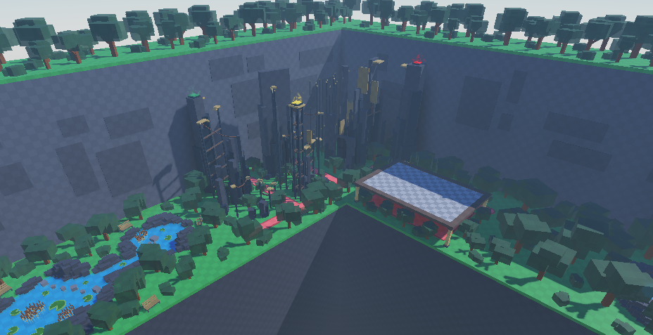

# The Baseplate

I used to make tons of ROBLOX games. This is one of them. If you aren't familiar with the platform or think it's childish (won't argue with that, honestly), skip ahead to the asynchronous events and Luau threads... like... the cool stuff.

<div align="center">
    
</div>

*The Baseplate* is inspired by games like *Plates of Fate* and *Horrific Housing*, which I used to play extensively with friends. The general idea behind those games is that of completely random chaos. Every 20 seconds or so, a new "event" is spawned, which spices up the game in some way. Like, an event may cause meteors to rain down, spawn zombies, give everyone weapons, or something harmless like adding party lights to the map. Eventually, the endless barrage of events is meant to make the survivor count slowly dwindle until one person is crowned the winner. Okay, simple.

But I wanted to take that a little further.

## A lack of chaos

This statement is a bit inaccurate. Those games are very chaotic. But, in a way, they don't reach their full chaos potential. Many events in these games don't leave lasting effects. Sure, having to avoid meteors for a minute can be challenging, but the game doesn't really get any harder after it's over. Only certain events stack, meaning the game isn't *as* utterly chaotic as it could be.

In my game, I decided to make *every* event stack. If meteors started to rain down, they'd continue doing so while rays of lightning crash down onto the baseplate and bombs rain down onto the players. I also wanted repeated events to be able to stack, so events could also have "intensity" (a "meteor shower" +1 would be twice as intense as a regular one, and a +2 would be thrice as insane, etc.).

<div align="center">
    
</div>

And, well, that's the game. Surviving a ton of random things coming at you at once. There are, like, at least 50 unique events. A lot of stuff that can happen at once.

## I want to try it!

Sure! You can play it <a href="https://www.roblox.com/games/137674317403002/the-baseplate">here</a>, though do keep in mind that this is a ROBLOX game and thus requires a ROBLOX account.

## How does it work? *(The fun part.)*

This game heavily leverages `task.spawn` and all those other Luau-thread-related `task` functions. Why? Because I needed a dynamic way to start and stop events, allowing them to run simultaneously and stack over each other.

When an event is created, it is "physically" spawned in an event folder, holding its intensity as an integer. At the same time, a thread is spawned, similar to this one:

```luau
-- This is the thread spawned for the "Meteor Shower" event
["Create"] = function(event, intensity)
  local singleTrigger = false
  local triggered = false
  
  while task.wait() do
    if (not checkExist(event, intensity)) then break end
    if (singleTrigger and triggered) then repeat task.wait() until (not checkExist(event, intensity)) break end
  
    triggered = true
  
    local marker = Instance.new("Part")
    marker.Name = "MeteorMarker"
    marker.CollisionGroup = "Events"
    
    local size = math.random(10, 30)
    marker.Orientation = Vector3.new(0, 90, 90)
    marker.Size = Vector3.new(workspace.Baseplate.Size.Y + 1 + tallest() + 0.01, size, size)
    marker.Shape = Enum.PartType.Cylinder
    
    local x = workspace.Baseplate.Position.X + math.random(workspace.Baseplate.Size.X / -2 + size / 2, workspace.Baseplate.Size.X / 2 - size / 2)
    local y = (workspace.Baseplate.Position.Y * 2 + tallest()) / 2
    local z = workspace.Baseplate.Position.Z + math.random(workspace.Baseplate.Size.Z / -2 + size / 2, workspace.Baseplate.Size.Z / 2 - size / 2)
    marker.Position = Vector3.new(x, y, z)
    
    marker.Color = Color3.fromRGB(255, 0, 0)
    marker.Material = Enum.Material.Neon
    marker.Transparency = 1
    
    marker.CanCollide = false
    marker.CanTouch = false
    marker.Anchored = true
    
    local otherMarker = marker:Clone()
    otherMarker.Size = Vector3.new(marker.Size.X + 200, marker.Size.Y, marker.Size.Z)
    otherMarker.Position = Vector3.new(marker.Position.X, marker.Position.Y + marker.Size.X / 2 + otherMarker.Size.X / 2, marker.Position.Z)
    otherMarker.Material = Enum.Material.ForceField
    
    marker.Parent = workspace.EventObjects
    otherMarker.Parent = workspace.EventObjects
    
    local info = TweenInfo.new(
      2,
      Enum.EasingStyle.Linear,
      Enum.EasingDirection.Out
    )
    
    local goal = {}
    goal.Transparency = 0.5
    
    local tween = tweenService:Create(marker, info, goal)
    tween:Play()
    
    local tween = tweenService:Create(otherMarker, info, goal)
    tween:Play()
    
    tween.Completed:Wait()
    
    local meteor = Instance.new("Part")
    meteor.Name = "Meteor"
    
    meteor.CollisionGroup = "Events"
    
    meteor.Size = Vector3.new(size, size, size)
    meteor.Shape = Enum.PartType.Ball
    
    meteor.Position = Vector3.new(marker.Position.X, marker.Position.Y + math.random(150, 250) + tallest(), marker.Position.Z)
    
    meteor.Color = Color3.fromRGB(50, 0, 0)
    meteor.Material = Enum.Material.Limestone
    
    meteor.CanCollide = true
    meteor.CanTouch = true
    meteor.Anchored = false
    
    local scr = templates.ObjectDamage:Clone()
    scr.Damage.Value = 5
    scr.Parent = meteor
    scr.Enabled = true
            
    meteor.Parent = workspace.EventObjects
    
    meteor.CollisionGroup = "Events"
    
    local info = TweenInfo.new(
      1,
      Enum.EasingStyle.Linear,
      Enum.EasingDirection.Out
    )
    
    local goal = {}
    goal.Transparency = 1
    
    local tween = tweenService:Create(marker, info, goal)
    tween:Play()
    
    local tween = tweenService:Create(otherMarker, info, goal)
    
    debris:AddItem(marker, 1)
    debris:AddItem(otherMarker, 1)
    
    local damageScript = templates.DamageScript:Clone()
    damageScript.Parent = meteor
    damageScript.Damage.Value = 50
    damageScript.Enabled = true
    
    local meteorScript = templates.MeteorTween:Clone()
    meteorScript.Parent = meteor
    meteorScript.Enabled = true
    
    local fire = Instance.new("Fire", meteor)
    fire.Heat = 5
    fire.Size = 20
    
    debris:AddItem(meteor, 10)
  end
end
```

Here, the `checkExist` function reveals how this system works:

```luau
local function checkExist(event, intensity)	
  if (event ~= nil) then
    if (event:IsDescendantOf(events)) then
      if (event.Intensity.Value >= intensity) then
        return true
      end
    end
  end
  return false
end
```

In summary, spawning a new event or increasing the intensity of an existing one always spawns a new thread that executes some loop of code to keep the event running, and is closed once the intensity is decreased (which can occur at random sometimes in my game) or when the game ends.

Though some events require cleanup. The meteor shower does not require much cleanup when it's removed, but some others do. For example, consider this event that changes player health:

```luau
["Create"] = function(event, intensity)
  local singleTrigger = true
  local triggered = false
  
  while task.wait() do
    if (not checkExist(event, intensity)) then break end
    if (singleTrigger and triggered) then repeat task.wait() until (not checkExist(event, intensity)) break end
    triggered = true
  
    values.BaseHealth.Value *= 0.75
    for _, player in pairs(playing()) do
      local char = player.Character

      if (char ~= nil) then
        local hum = char.Humanoid
        hum.MaxHealth = values.BaseHealth.Value * char.Multipliers.Health.Value
        
        if (hum.Health > hum.MaxHealth) then
          hum.Health = hum.MaxHealth
        end
      end
    end
  end
  
  values.BaseHealth.Value /= 0.75
  for _, player in pairs(playing()) do
    local char = player.Character
  
    if (char ~= nil) then
      local hum = char.Humanoid
      hum.MaxHealth = values.BaseHealth.Value * char.Multipliers.Health.Value
      
      if (hum.Health > hum.MaxHealth) then
        hum.Health = hum.MaxHealth
      end
    end
  end
end
```

This event requires the players' health values to be restored once the event ends, so that is arranged by adding more code after the loop.

If you're more of a visual learner, here's a diagram showing how events work, kind of:

<div align="center">
    
</div>

### Maps and Abilities

I use similar modular structures to handle abilities (another big part of my game) and maps/gamemodes. Abilities are triggered when players have one equipped and hit the activation key (Q or E). 

Here's a snippet of one ability that links players together while making them all stronger:

```luau
["Interconnected"] = {
  ["Name"] = "Interconnected",
  ["Description"] = "All players using this skill become stronger, but are all life-linked.",
  ["Icon"] = "rbxassetid://104759612335440",

  ["Price"] = 1500,
  ["Cooldown"] = -1,

  ["Create"] = function(player, charged)
    local friends = {}
    for _, otherPlayer in pairs(playing()) do
      local skills = {otherPlayer.Skills.Skill1.Value, otherPlayer.Skills.Skill2.Value}
      
      if (table.find(skills, "Interconnected") ~= nil) then
        table.insert(friends, otherPlayer)
        
        if (table.find(skills, "Overcharged") ~= nil) then
          table.insert(friends, otherPlayer)
        end
      end
    end
    
    local char = player.Character
    if (char ~= nil) then
      char.Multipliers.Speed.Value += 0.125 * (#friends - 1)
      setSpeed(player)
      
      char.Multipliers.Health.Value += 0.5 * (#friends - 1)
      char.Humanoid.MaxHealth += 50 * (#friends - 1)
      char.Humanoid.Health = char.Humanoid.MaxHealth
      
      char.Humanoid.Died:Connect(function()
        for _, otherPlayer in pairs(friends) do
          if (table.find(playing(), otherPlayer) ~= nil) then
            local otherChar = otherPlayer.Character
            
            if (otherChar ~= nil) then
              otherChar.Humanoid.Health = 0
            end
          end
        end
      end)
    end
  end
},
```

As you can see, it has a somewhat similar structure where everything is split into modular table instances, and all that you need to do to use one is activate the respective function.

The same goes for gamemodes/maps. Here's an example of one:

```luau
-- Lightning gamemode; increases event spawning rate to create even more chaos
["Lightning"] = {
  ["Name"] = "Lightning",
  ["Icon"] = "rbxassetid://97644591708481",

  ["Create"] = function()
    defaultPlate()
    values.EventSpeed.Value = 2
  end
},
```

---

<div align="center">
    
</div>

And, well, that's it. Thanks for taking the time to read through this, if you did; it's nice to see someone appreciate such a niche project. I put a lot of effort into the art, maps, and events, and even if it's just a thing I made to play with my friends, it's been fun. Thanks!
